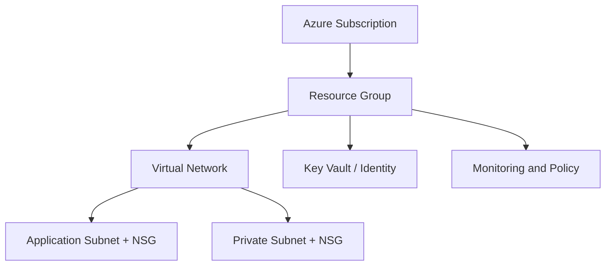

<div align="center">


[](https://developer.hashicorp.com/terraform)
[](https://azure.microsoft.com/)
[](https://github.com/haqueamir70-coder)

</div>

> **Portfolio project:** implementation status and limitations are documented below. The diagram describes the intended workflow/architecture and is not proof of a successful production deployment.

## 🗺️ Architecture at a Glance



---

# Azure Production Landing Zone (Terraform)

A portfolio project for building a repeatable Azure infrastructure foundation with Terraform. This repository is intended to demonstrate Infrastructure as Code structure, network segmentation, and security-conscious configuration. Review the current code and validate it in a non-production subscription before using it for real workloads.

## Implemented in the current Terraform configuration

- Azure Resource Group
- Azure Virtual Network with configurable address space
- Application and private subnets
- Separate Network Security Groups for the subnets
- Subnet-to-NSG associations
- An inbound HTTPS rule for the application NSG
- An inbound Internet-deny rule for the private NSG
- Azure Key Vault configured for RBAC authorization
- User-assigned managed identity

The exact resources and defaults are defined in `main.tf`, `provider.tf`, and `variables.tf`. Confirm the current repository state before relying on this summary.

## Technology stack

- Microsoft Azure
- Terraform
- HashiCorp AzureRM provider
- Git and GitHub

## Repository structure

```text
.
├── main.tf
├── provider.tf
├── variables.tf
├── terraform.tfvars.example
├── .terraform.lock.hcl
├── .gitignore
└── README.md
```

## Prerequisites

1. An Azure subscription and permission to create the resources in this configuration.
2. Terraform installed locally.
3. Azure CLI installed and authenticated, or another supported Azure authentication method.
4. A unique Key Vault name that meets Azure naming requirements.
5. A non-production subscription for testing.

## Authenticate to Azure

For local development, use the Azure CLI:

```bash
az login
az account show
az account set --subscription "<SUBSCRIPTION_ID>"
```

Do not commit client secrets, access tokens, state files, or real `terraform.tfvars` values. For CI/CD, prefer workload identity federation/OIDC or managed identity where available, with narrowly scoped permissions.

## Configure and validate

Review the variables and copy the example file if needed:

```bash
cp terraform.tfvars.example terraform.tfvars
terraform init
terraform fmt -check -recursive
terraform validate
terraform plan
```

Inspect the plan carefully before applying. Apply only when you understand the proposed changes and have selected the intended subscription:

```bash
terraform apply
```

Clean up test resources when finished, after confirming that deletion will not affect anything you need:

```bash
terraform plan -destroy
terraform destroy
```

## Security and production-readiness notes

This is a **portfolio/reference implementation, not a claim of a fully production-certified landing zone**. Before production use, review and test at least the following:

- Enable Key Vault purge protection and choose an appropriate soft-delete retention policy.
- Validate NSG rules against the actual threat model; avoid broad Internet access unless explicitly required.
- Add explicit Key Vault network controls, diagnostic settings, logging, alerting, and retention.
- Define RBAC assignments for the managed identity and validate least privilege.
- Use a remote Terraform backend with locking, access controls, and protected state.
- Add automated formatting, validation, security scanning, plan review, and protected apply approvals.
- Test naming, region availability, quotas, policy requirements, and cost in the target subscription.

## Roadmap

- Add CI checks for `terraform fmt`, `terraform validate`, and infrastructure security scanning.
- Add a documented remote state backend pattern.
- Add monitoring and diagnostic settings.
- Add environment separation and reusable modules where justified.
- Publish validation evidence and an architecture diagram.

## Author

MD Amirul Haque · [GitHub profile](https://github.com/haqueamir70-coder) · [LinkedIn](https://www.linkedin.com/in/md-amirul-haque/)
