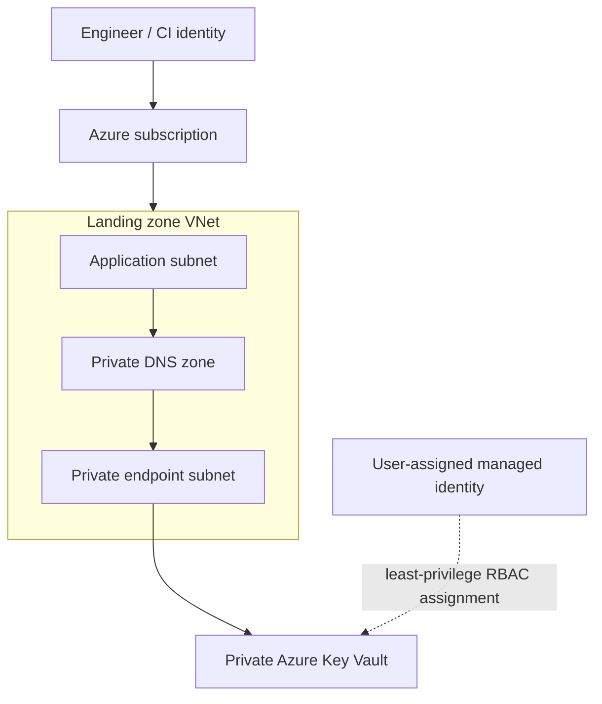

# Azure Production Landing Zone — Terraform Foundation

> **Status:** Terraform foundation reference with CI formatting/validation. The code is not represented as deployed infrastructure. Review the Terraform plan and security posture before applying to any subscription.

## What this project builds

- Resource group and segmented virtual network.
- Application and private-endpoint subnets.
- Separate NSGs with subnet associations.
- Private-only Azure Key Vault using RBAC authorization.
- Key Vault Private Endpoint and Private DNS integration.
- User-assigned managed identity.
- Terraform outputs for downstream modules and pipelines.

## Network and security design

The application subnet does **not** allow direct Internet ingress. Its sample HTTPS rule allows traffic only from the VNet. Add an approved Application Gateway, Front Door or other ingress tier with narrowly scoped source ranges when a workload requires external access.

The Key Vault has public network access disabled, default-deny network ACLs, a private endpoint, private DNS integration, 90-day soft delete and purge protection. A client must have both a private network route/DNS resolution and an authorized Microsoft Entra identity. The managed identity is created as a foundation component; workload role assignments should be scoped to the actual consuming application and are not granted broadly by this project.

## Architecture



## Prerequisites

- Terraform CLI 1.6+
- Azure CLI authenticated to the intended test subscription
- Permissions to create networking, Key Vault, private endpoint, DNS link and managed identity resources
- A globally unique Key Vault name (3–24 characters)

## Validate and deploy

```bash
terraform fmt -check -recursive
terraform init -backend=false
terraform validate
terraform plan -out=tfplan
terraform show -no-color tfplan
```

Apply only after reviewing the complete plan, subscription, region, address ranges, naming availability and expected costs:

```bash
terraform apply tfplan
```

Use remote state with access controls and locking for team use. Never commit state, plan files, credentials or real `terraform.tfvars`.

## Operational checks after deployment

1. Confirm the Key Vault private endpoint connection is approved.
2. Resolve `<vault-name>.vault.azure.net` from a client in the linked VNet and verify private-link resolution.
3. Confirm the client has the intended Key Vault RBAC role; network reachability does not grant data access.
4. Test secret access from a private workload identity.
5. Verify diagnostic logging, alert routing and recovery ownership before production use.

## CI

GitHub Actions runs Terraform formatting, backend-free initialization and validation plus an advisory Checkov scan. Triage scanner findings before treating this as a blocking production security gate. CI validates configuration syntax; it does not prove subscription permissions, resource availability, private DNS operation or a live deployment.

## Author

MD Amirul Haque · [GitHub profile](https://github.com/haqueamir70-coder) · [LinkedIn](https://www.linkedin.com/in/md-amirul-haque/)
