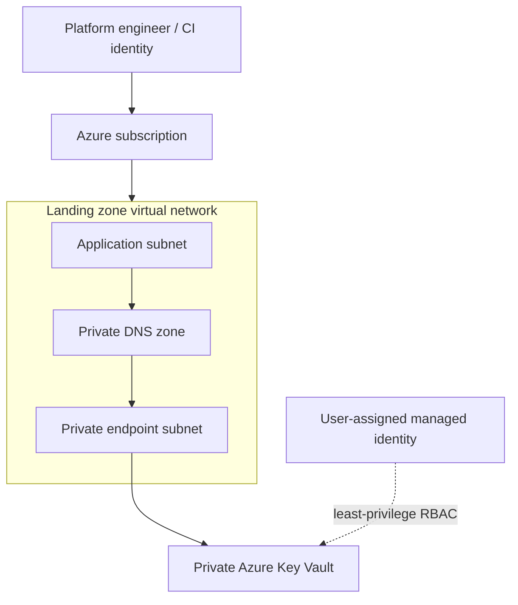

<div align="center">


### Network segmentation · Private platform services · Identity-first access

[](https://azure.microsoft.com/)
[](https://developer.hashicorp.com/terraform)
[](https://learn.microsoft.com/azure/private-link/)

**A Terraform foundation for an Azure workload landing zone, combining segmented subnets, network security groups, private Key Vault access and managed identity building blocks.**

[Architecture](#-architecture) · [Security controls](#-security-controls) · [Quick start](#-validate-and-plan) · [Operations](#-post-deployment-validation)

</div>

> [!IMPORTANT]
> The repository is a Terraform foundation reference with CI formatting/validation. It is **not** represented as deployed infrastructure. Review the target subscription, plan, security controls and cost before applying.

## What this foundation is designed to solve

Workloads need predictable network boundaries and controlled access to platform services. This lab demonstrates a small landing-zone slice where application traffic, private endpoints, DNS and workload identity are modelled explicitly instead of relying on public service endpoints.

## Architecture



## Foundation components

| Component | Design |
|---|---|
| Resource group | Workload boundary and tagging foundation |
| Virtual network | Segmented address space |
| Application subnet | Workload network zone; no direct Internet ingress rule |
| Private endpoint subnet | Private Link attachment point |
| Network security groups | Separate subnet-level controls |
| Azure Key Vault | RBAC authorization, private access, soft delete and purge protection |
| Private DNS | Private-link name resolution |
| User-assigned identity | Reusable workload identity building block |

## Security controls

- Application subnet sample HTTPS access is scoped to the VNet service tag; it is not a public ingress path.
- Key Vault public network access is disabled and network ACLs default to deny.
- Key Vault uses RBAC authorization, 90-day soft delete and purge protection.
- Private Endpoint and Private DNS integration are included in the design.
- Managed identity creation does not imply broad data-plane permissions. Assign workload roles narrowly and deliberately.
- Network reachability and identity authorization must both succeed for a workload to retrieve a secret.

## Validate and plan

### Prerequisites

- Terraform CLI 1.6+.
- Azure CLI authenticated to the intended non-production subscription.
- Permissions for resource groups, networking, Key Vault, Private Endpoint, DNS and managed identity resources.
- A globally unique Key Vault name; check the actual Azure naming constraints for the selected resource.

### Static validation

```bash
terraform fmt -check -recursive
terraform init -backend=false
terraform validate
```

### Review the plan

```bash
terraform plan -out=tfplan
terraform show -no-color tfplan
```

Apply only after checking subscription, region, CIDRs, name availability, role assignments, resource SKUs and estimated cost. Use a secured remote backend with locking for shared work. Never commit state, plan files, credentials or real `terraform.tfvars`.

## Post-deployment validation

If you deploy this foundation in a test subscription, verify each layer independently:

1. Confirm the VNet and subnet address ranges do not overlap with connected networks.
2. Confirm NSGs are associated with the intended subnets and inspect effective security rules.
3. Confirm the Key Vault Private Endpoint connection is approved.
4. Resolve the vault hostname from a client in the linked VNet and verify private DNS returns the expected private address.
5. Confirm the workload identity has only the required Key Vault data-plane role.
6. Test secret retrieval from the intended private workload path.
7. Enable diagnostics and verify logs reach the chosen monitoring destination.

## CI and evidence

GitHub Actions runs formatting, backend-free initialization and Terraform validation plus an advisory Checkov scan. CI validates configuration, not the live subscription, endpoint approval, DNS resolution or application access. Use the repository [Actions page](../../actions) to inspect current runs.

## Next steps

- [ ] Add explicit environment/subscription boundaries and policy assignments.
- [ ] Add a documented hub/spoke or approved ingress design where required.
- [ ] Add workload-specific RBAC role assignments.
- [ ] Add diagnostics, alerting and operational ownership.
- [ ] Run a controlled deployment and attach genuine validation evidence.
- [ ] Add cost estimates and a teardown procedure.

## Documentation

- [Architecture and interview guide](docs/README.md)
- [Zero-to-hero implementation guide](docs/ZERO-TO-HERO.md)
- [Advanced interview bank](docs/ADVANCED-INTERVIEW-BANK.md)

## Maintainer

**MD Amirul Haque** · [GitHub](https://github.com/haqueamir70-coder) · [LinkedIn](https://www.linkedin.com/in/md-amirul-haque/)

<sub>Establish the boundary first. Then connect identity, network and operations.</sub>
