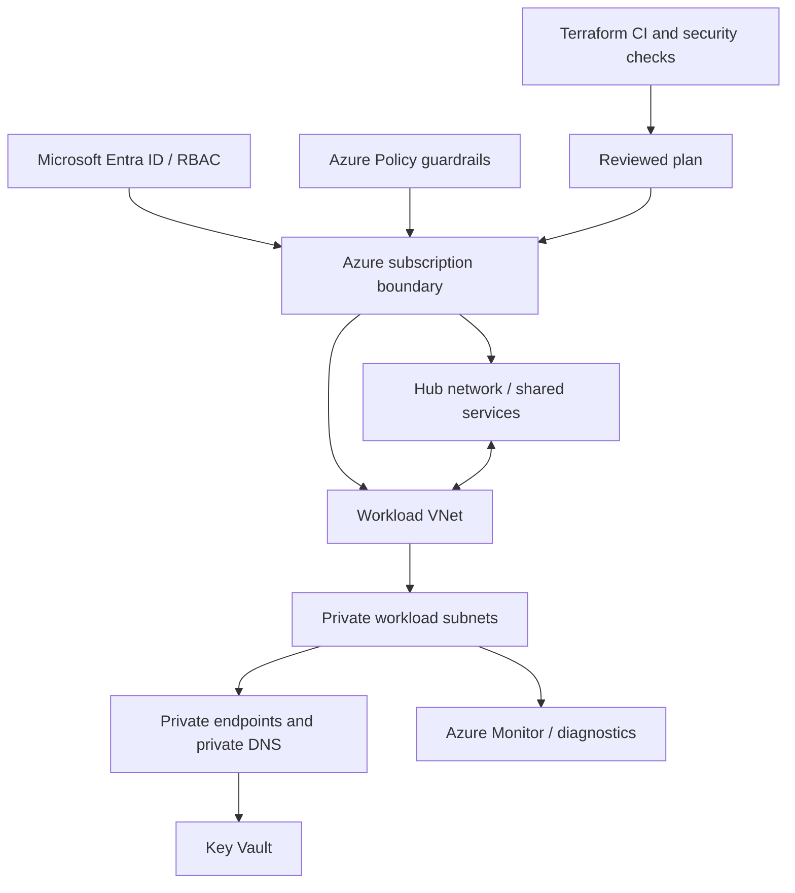

# Azure production landing zone foundation — Architecture & Interview Guide

A baseline landing-zone flow covering identity, network, policy, private services and observability. Subscription management groups and policy assignments must be distinguished from resources actually provisioned by this repository.

## Architecture diagram

## Interview questions

1. 1. What are the core components of an Azure landing zone?
2. 2. How do management groups, subscriptions and resource groups differ?
3. 3. How do Azure Policy and RBAC complement each other?
4. 4. Explain hub-and-spoke networking and its trade-offs.
5. 5. Why are private endpoints and private DNS critical?
6. 6. How do you design identity and privileged access for platform teams?
7. 7. How do you organize Terraform state across platform and workload layers?
8. 8. What is the role of Azure Firewall, route tables and NSGs?
9. 9. How do you enforce tagging, allowed regions and diagnostic settings?
10. 10. What evidence is required before describing a landing zone as production-ready?

## Interview preparation note
For each answer, cover the design rationale, trust boundary, failure mode, operational telemetry and validation method. Distinguish implemented, CI-validated, cloud-deployed and planned capabilities.

## Interview questions — suggested answers

### 1. Answer

An Azure landing zone provides subscription hierarchy, identity/access, network topology, policy/governance, management/monitoring and workload landing-zone patterns.

### 2. Answer

Management groups organize subscriptions for governance; subscriptions are billing/management and isolation boundaries; resource groups organize lifecycle of resources.

### 3. Answer

RBAC grants permissions to identities; Azure Policy evaluates/enforces resource configuration. Policy can audit/deny/deploy settings, while RBAC controls who can change resources.

### 4. Answer

Hub-spoke centralizes shared services/security in a hub and isolates workloads in spokes. It improves governance but introduces routing, DNS and hub availability complexity.

### 5. Answer

Private endpoints keep service access on private IPs; private DNS ensures service names resolve to those IPs. Both routing and DNS must be correct.

### 6. Answer

Use least privilege, PIM/JIT elevation, managed identities, break-glass accounts, access reviews and centralized audit. Separate platform and workload administration.

### 7. Answer

Separate state by lifecycle/ownership and blast radius. Use secure remote backend, locking, restricted identities and versioned state; avoid one giant state file.

### 8. Answer

Firewall provides centralized inspection/egress control, route tables direct traffic, NSGs filter subnet/NIC flows. Layer controls based on trust boundaries.

### 9. Answer

Use policy initiatives for allowed locations/SKUs, mandatory tags and diagnostics; test deny policies in audit mode before enforcement and define exemptions with expiry.

### 10. Answer

Show deployed resource IDs, policy assignments, identity setup, network/DNS tests, diagnostic ingestion and operational runbooks. Terraform validate alone is not proof.